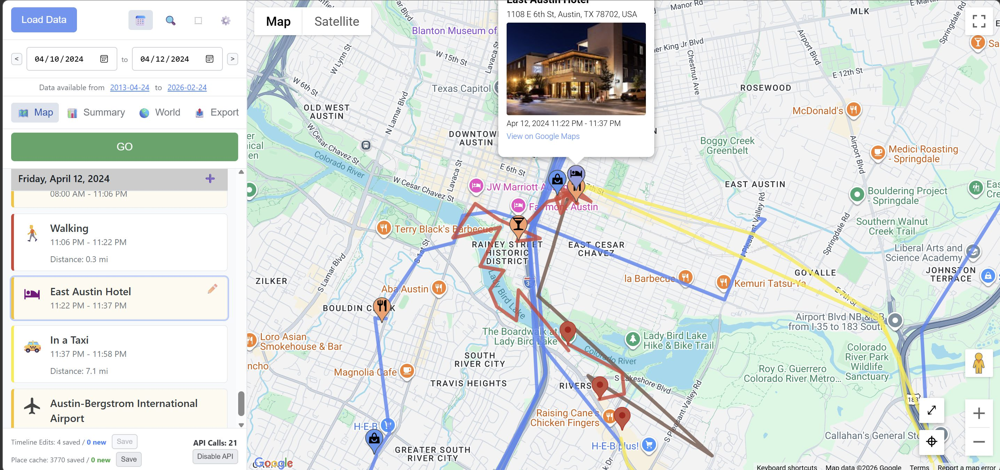
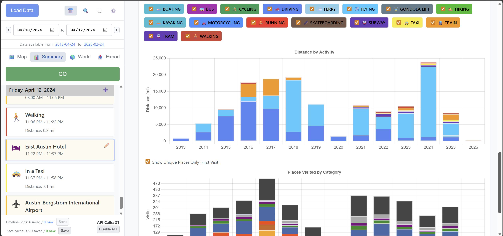
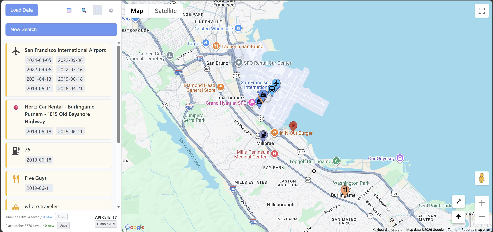
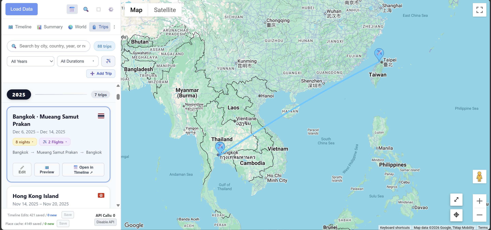

# Google Maps Timeline Viewer
This project is a feature-rich replacement for the discontinued Google Maps desktop timeline site.

Since Google transitioned to storing location history locally on your device rather than in the cloud, exploring years of travel data on a larger screen became nearly impossible. This Timeline Viewer allows you to visualize, search, and map your location history, and supports both the current on-device data format (exported from your phone) and the legacy format from Google Takeout.

### Features:
- Supports both Google Takeout data and On-Device data file (Android or iOS)
- Timeline and map view
- Duration of visits ; distance traveled (in km or miles)
- Travel modes color-coded ; direction of travel arrows when clicking a path
- View multiple days at once
- Search by place name to find dates with visits
- Find all visited places within the viewable map area
- Summary of activities by year/month, with bar charts
- Trips View automatically detects vacations and travels away from home, with duration filters and flight detection
- Animated Journey Replay animates your route for any day, date range, or trip with a live clock, scrubber, speed controls, and trailing path
- World View shows a heat map of your activity, and a list of countries and cities visited
- Timeline items are editable, including route paths
- Timezone detection for viewing your travel days with local times
- Place details retrieved from Google Places API can be saved locally, to reduce future API calls
- Import gps locations from a folder of photos (in combination with exiftool)
- Export to KML file
- Mobile-friendly UI, so you can use this on your phone

<p align="center">
  <a href="/screenshot.jpg"></a>
  <a href="/screenshot2.jpg"></a>
</p>

<p align="center">
  <a href="/screenshot3.jpg"></a>
  <a href="/screenshot5.jpg"></a>
</p>

#

Setup only takes a few minutes and doesn't require any special technical skills. Just follow these steps:

## Get Your Data: Option 1, On-Device data export
1. For Android: Open the Settings app, tap "Location", then "Location services", then "Timeline" and then "Export Timeline data".   
   For iOS: Open the Google Maps app, tap your profile picture, select "Settings" and then "Location & Privacy". Tap "Export Timeline data".
2. Save the exported file as "Timeline.json". (On non-English devices, the default file name may be different -- be sure to save the file as "Timeline.json")
3. Transfer the JSON file to your computer, and save it anywhere you like, eg My Documents.


## Get Your Data: Option 2, Google Takeout (No longer available once you've started using on-device data)
1. **Go to Google Takeout:**
   - Visit [Google Takeout](https://takeout.google.com/).

2. **Select Data to Include:**
   - Click "Deselect all".
   - Scroll down and select **Timeline**. (The default format is JSON, which is what we want.)
   - Click "Next step".

3. **Customize Export Format:**
   - Choose the delivery method, etc. Doesn't matter what you choose here.
   - Click "Create export".

4. **Download the Export:**
   - Once the export is ready, download the file.
   - Extract the archive to anywhere you like, eg My Documents.
   - Ensure that the archive contained a folder called "Location History (Timeline)". If not, you'll need to use on-device data, as described above. (Note that "Timeline Edits.json" is *not* the same as the "Timeline.json" that comes from your device.)


## Map Provider: Google Maps or OpenStreetMap

Using Google Maps as the map provider is recommended, as it's required for place name lookups. Setup is very simple but requires a couple of extra steps, described below. As an alternative, you can use OpenStreetMaps, which requires no additional setup. You can switch at any time.

### Obtaining a Google Maps API Key (Optional)

1. **Go to the Google Cloud Console:**
   - Visit [Google Cloud Console](https://console.cloud.google.com/).

2. **Create a New Project:**
   - Click on the project drop-down and select "New Project".
   - Enter a name for your project and click "Create".

3. **Enable APIs:**
   - In the Cloud Console, go to **APIs & Services**.
   - Search for the following APIs and enable them:
      - **Maps JavaScript API**
      - **Maps Embed API**
      - **Places API (New)**
   - You'll need to enable Billing to use the APIs. With normal use, you shouldn't incur any charges. See bottom of this doc for more info.

4. **Create API Key:**
   - Go to **APIs & Services > Credentials**.
   - Click "Create Credentials" and select "API Key".
   - Copy the generated API key.

5. **Restrict API Key (Optional):**
   - In the API key's settings, under **API restrictions**, select "Restrict key" and choose the APIs you enabled.


##  Final Set Up
1. **Download The Google Maps Timeline Viewer:**
   - Save this project's [timeline.html](https://raw.githubusercontent.com/kurupted/google-maps-timeline-viewer/refs/heads/main/timeline.html) file anywhere you like, either on your computer (eg in My Documents) or on your mobile device. (To save, copy/paste the text into eg Notepad, and save as "timeline.html")

2. **Add your API key:**
   - When you first open `timeline.html`, the app will ask for your Google Maps API key. If you choose to remember it, the key will be saved in your browser's storage, so you won't need to enter it again.
   - If you change browsers or devices, clear your browser data, or move/rename the `timeline.html` file, you may need to enter the key again.


### Optional: Store Your API Key within Your Project Files
_Option 1: Local config file:_

Create a file named `timeline.local.js` next to `timeline.html`:

```js
window.TIMELINE_VIEWER_CONFIG = {
    googleMapsApiKey: "YOUR_API_KEY"
};
```

Replace `YOUR_API_KEY` with the key you obtained from the Google Cloud Console.

_Option 2: Edit `timeline.html`_

Open `timeline.html` in a text editor and find the code below, near the top:

```html
<script>
   window.GOOGLE_MAPS_API_KEY = "YOUR_API_KEY"; // Optional fallback; leave unchanged to use the in-app key prompt.
```

Replace `YOUR_API_KEY` with the key you obtained from the Google Cloud Console, and save.


## View Your Timeline
1. **Open the timeline.html File:**
   - Open the file on your computer or mobile device. (Alternatively, you can [run timeline.html directly from GitHub](https://kurupted.github.io/google-maps-timeline-viewer/timeline.html). No data is transmitted to GitHub or to me; everything still runs locally in your browser.)
   - At the top left of the page, click **Load Data** (or use the **▾** menu to pick JSON files directly, or drag & drop your folder / `Timeline.json` onto the page):
      - For Google Takeout data: Navigate to `Takeout\Location History (Timeline)\Semantic Location History` and select that parent folder. (Do not navigate into one of the year folders.)
      - For On-Device exported data: Choose the folder that contains your exported `Timeline.json` file, or select the JSON file directly (along with any optional `TimelinePlaceCache.json`, `TimelineEdits.json`, or `TimelineTrips.json` files).
   - In Chrome and Edge (when opened via folder selection or folder drag & drop), saving your Place Cache, Timeline Edits, or Trip customizations writes directly back to your data folder after you grant write access. In other browsers, it automatically falls back to downloading the JSON file, which you can then save to your folder manually.
   - Firefox users: Firefox will ask you to "Upload" your data when you load it, but this is simply a quirk of the permission dialog - your data never leaves your computer.
   - Android users: You may not be allowed to load the data if it's in certain folders, such as Downloads -- move the data file to an accessible location.

## Note on API Usage & Billing
- You can find the free usage limits, and over-the-limit pricing here: https://developers.google.com/maps/billing-and-pricing/pricing#places-pricing
- Depending on what information is requested during the API call, it will fall into tiers, eg Essentials or Pro. Details here:
  https://developers.google.com/maps/billing-and-pricing/sku-details#place-details-pro-sku
- At this time, the monthly free limits are 1,000 Place Photos, 5,000 Pro-level requests, and 10,000 Essentials-level requests.
- There is also an option within the Timeline Viewer to disable API calls, which will still show your activity paths and place visits, however all of the places will be labeled "Unknown Location".
- You can also save retrieved Place data to a file, which will be loaded automatically next time, to avoid API calls that were done previously.
  
